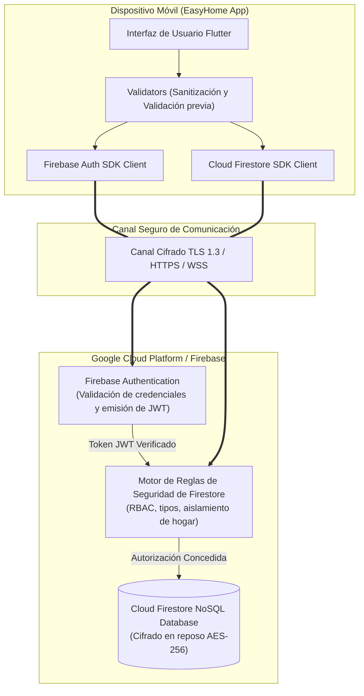
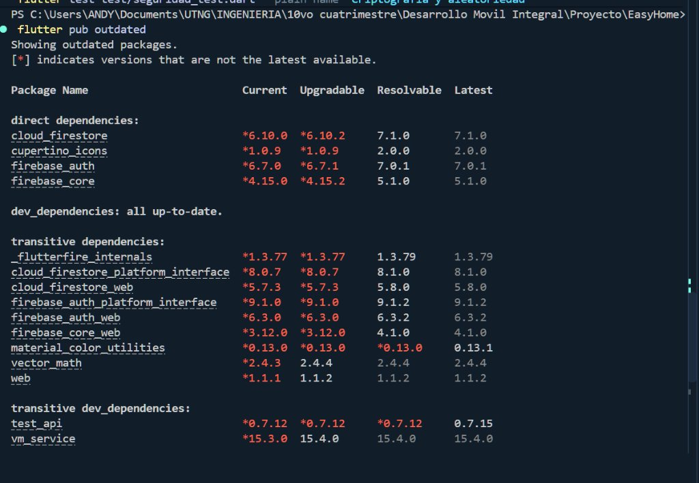
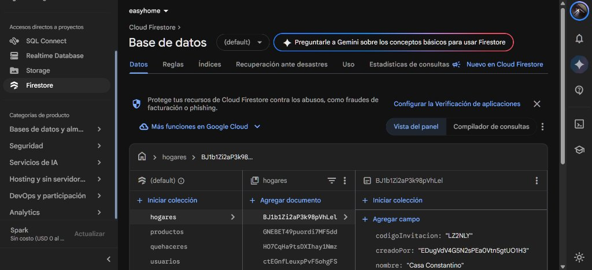
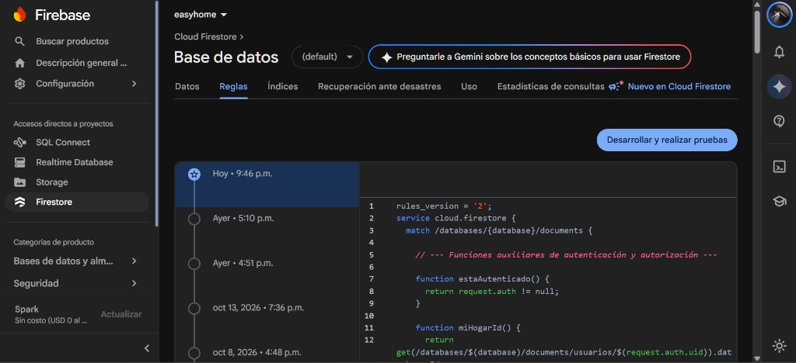
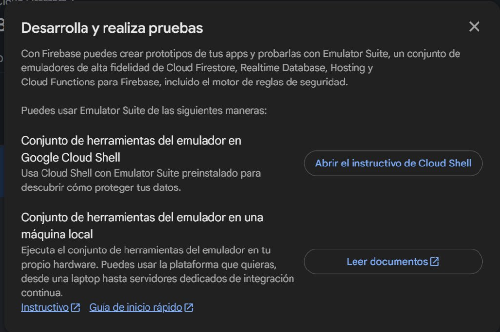

# Documento de Seguridad Integral y Servicios en la Nube — EasyHome

> **Proyecto:** EasyHome (Desarrollo Móvil Integral - UTNG)  
> **Equipo:** Juana Jaqueline Camarillo Olaez, Carol Guadalupe Ríos Rios, Princes Rocio Guerrero Sanchez  
> **Profesor:** Anastacio Rodríguez García  
> **Fecha de actualización:** 10 de noviembre de 2026  
> **Rama:** `feat/seguridad`  

---

## 1. Objetivo y Alcance

### Objetivo
Garantizar la confidencialidad, integridad y disponibilidad de la información de los hogares compartidos (cuentas, listas de compras, perfiles y quehaceres), asegurando que **únicamente los integrantes autorizados** puedan visualizar y modificar sus datos respectivos.

### Alcance
- **Firebase Authentication:** Políticas de contraseñas, control anti-enumeración de usuarios, reautenticación y restablecimiento de contraseña.
- **Cloud Firestore Security Rules:** Endurecimiento del control de acceso basado en roles (RBAC), aislamiento estricto por `hogarId`, validación de tipos, rangos y longitudes en el servidor.
- **Cliente Flutter:** Sanitización de entradas, validación previa al envío, principios de privilegios mínimos en permisos de la plataforma móvil (Android/iOS) y eliminación de exposición de trazas sensibles.
- **Gestión de Secretos:** Exclusión de credenciales reales del control de versiones mediante `.gitignore` y provisión de plantillas de configuración con valores ficticios (`.example`).

---

## 2. Modelo de Amenazas (STRIDE / OWASP Mobile)

| Amenaza | Vector de Ataque | Impacto | Control Implementado |
| :--- | :--- | :--- | :--- |
| **Spoofing (Suplantación)** | Intento de personificar a otro usuario o inicio de sesión no autorizado. | Acceso a hogares ajenos. | Autenticación delegada a Firebase Auth con tokens JWT criptográficamente firmados por Google. |
| **Tampering (Manipulación)** | Modificación de quehaceres o productos de otros hogares vía API directa. | Alteración de listas y tareas del hogar. | `firestore.rules` valida en servidor que `resource.data.hogarId == miHogarId()`. |
| **Repudiation (Repudio)** | Negar la creación o alteración de quehaceres o listas. | Confusión en tareas del hogar. | Campo obligatorio `creadoPor == request.auth.uid` y validación de autoría en reglas. |
| **Information Disclosure (Fuga de datos)** | Enumeración de cuentas en login o lectura masiva de hogares/códigos de invitación. | Extracción de correos o códigos de hogares ajenos. | Mensajes de login homogéneos (*"Correo o contraseña incorrectos"*), colección `codigosInvitacion` clausurada (`allow read, write: if false`) y códigos consultables solo por coincidencia exacta. |
| **Denial of Service (DoS)** | Inyección de textos kilométricos o cantidades absurdas que rompan la UI. | Fallo visual o cuelgue de la app. | `validators.dart` y `firestore.rules` imponen límites estrictos de longitud (máximo 60 caracteres en nombres, 120 en quehaceres, 99,999 en cantidades). |
| **Elevation of Privilege (Elevación de roles)** | Usuario que envía actualización `esAdministrador: true` sobre su documento. | Tomar control administrativo de un hogar ajeno o propio sin permiso. | Regla endurecida en `usuarios/{uid}`: autoasignación de `esAdministrador = true` bloqueada; solo el creador al crear el hogar o un admin legítimo puede otorgar el rol. |

---

## 3. Arquitectura de Seguridad e Integración en la Nube



---

## 4. Matriz de Servicios en la Nube y Datos Intercambiados

| Servicio | Propósito en EasyHome | Datos Intercambiados | Permisos y Límites de Acceso | Clasificación de Parámetros |
| :--- | :--- | :--- | :--- | :--- |
| **Firebase Authentication** | Gestión de identidad, registro, login y restablecimiento de contraseña. | Correo electrónico, contraseña (hasheada en servidor mediante Scrypt), UID. | Acceso público a registro/login; operaciones de sesión restringidas al propio usuario. | **Público:** `apiKey`, `appId`<br>**Privado:** Contraseñas (nunca viajan en claro), tokens de sesión. |
| **Cloud Firestore** | Almacenamiento no relacional en tiempo real de entidades del hogar. | Documentos de `usuarios`, `hogares`, `productos`, `quehaceres`. | Lectura y escritura condicionadas por `firestore.rules` al `hogarId` del token autenticado; regla por defecto denegar todo (*catch-all*). | **Público:** `projectId`<br>**Privado:** Reglas de base de datos, llaves de cuenta de servicio de backend. |
| **Firebase Cloud Messaging (FCM)** | Notificaciones push a integrantes del hogar ante asignación de quehaceres o compras (#21). | Tokens de registro del dispositivo (`fcmToken`), payload JSON de notificación (título, cuerpo, sección destino). | Tokens almacenados en `/usuarios/{uid}` visibles únicamente para integrantes del mismo hogar; despacho validado por el backend seguro. | **Público:** `messagingSenderId`<br>**Privado:** Tokens FCM de usuarios, llaves de servidor FCM. |
| **Notificador Local (Node.js Worker)** | Worker desacoplado que escucha Firestore (`onSnapshot`) y despacha notificaciones FCM vía Firebase Admin SDK sin costo de Cloud Functions. | Llave de cuenta de servicio (`serviceAccountKey.json`), snapshots de quehaceres/productos y tokens FCM. | Ejecución en entorno seguro; cuenta de servicio con permisos mínimos de lectura en Firestore y envío en FCM; credenciales estrictamente fuera de Git. | **Público:** Ninguno<br>**Privado:** Archivo de credencial `serviceAccountKey.json`, variables de entorno `.env`. |

### 4.1 Evolución de la Arquitectura y Justificación Técnica de Servicios

En las fases de diseño inicial se analizaron alternativas de infraestructura en la nube. Con base en los requerimientos académicos y directrices de seguridad, se tomaron las siguientes decisiones de arquitectura:

1. **Sustitución de Cloud Functions por Notificador Local Node.js (#21):**
   - *Motivo:* El despliegue de Firebase Cloud Functions requiere forzosamente la suscripción al **plan Blaze** (pago por consumo con tarjeta de crédito), incompatible con la política de desarrollo libre de costos del curso.
   - *Solución:* Se implementó un microservicio desacoplado en `/notificador` empleando **Firebase Admin SDK** con listeners reactivos (`onSnapshot`). Posee una suite propia de 17 pruebas unitarias con Jest (`npm test`), alcanzando paridad funcional idéntica a Cloud Functions sin costos operativos.

2. **Sustitución de Cloud Storage por Almacenamiento Vectorial en Firestore:**
   - *Motivo:* Gestionar imágenes binarias en Cloud Storage implicaba definir buckets públicos/privados y reglas adicionales de almacenamiento.
   - *Solución:* Los perfiles de usuario utilizan avatares generados algorítmicamente y códigos de color hexadecimales persistidos como strings ligeros dentro del documento `/usuarios/{uid}`, eliminando la superficie de ataque de subida de archivos maliciosos.

3. **Autenticación con Correo/Contraseña en lugar de Google Sign-In:**
   - *Motivo:* Reducir la fricción de dependencias nativas complejas en emuladores y evitar discrepancias de firmas SHA-1 en equipos de desarrollo heterogéneos, fortaleciendo en su lugar políticas estrictas de contraseñas y mitigación de enumeración de cuentas.

---

## 5. Endurecimiento de Reglas de Seguridad (`firestore.rules`)

El archivo [`firestore.rules`](../firestore.rules) implementa los siguientes controles verificables:

1. **Aislamiento Multi-Tenant por Hogar y Perfiles Blindados:**
   - Ningún usuario puede leer ni modificar documentos de `productos` o `quehaceres` si el `hogarId` del documento no coincide con el del usuario (`resource.data.hogarId == miHogarId()`).
   - En la colección `usuarios/{uid}`, la lectura está restringida a que el usuario sea el propio titular (`request.auth.uid == uid`) o pertenezca a su mismo hogar (`resource.data.hogarId == miHogarId()`), impidiendo que usuarios autenticados externos consulten tokens FCM o datos de otros hogares.
2. **Control de Rol de Administrador e Integridad al Unirse:**
   - Un usuario no puede autoasignarse rol de administrador (`esAdministrador == false`).
   - Al unirse a un hogar, se valida la existencia física del hogar de destino (`exists(/databases/$(database)/documents/hogares/$(request.resource.data.hogarId))`).
   - Solo el creador original del hogar o un administrador legítimo puede otorgar permisos administrativos.
3. **Rotación Semanal Segura de Quehaceres (#20):**
   - Cualquier integrante del hogar puede rotar tareas recurrentes (`recurrente == true`), pero **únicamente** modificando los campos `asignadoA` y `hecho` (`hasOnly(['asignadoA', 'hecho'])`).
   - El título, configuración y eliminación permanecen protegidos exclusivamente para el administrador.
4. **Validación de Esquema y Tamaño de Campos:**
   - Función `esTextoValido(val, minLen, maxLen)` para garantizar que ningún campo contenga tipos inesperados ni longitudes desbordadas.
   - Cantidades de productos deben ser de tipo `int` y estrictamente mayores a `0`.
5. **Cierre de Colecciones en Desuso y Regla por Defecto (Catch-All):**
   - La colección `codigosInvitacion` queda cerrada (`allow read, write: if false;`).
   - Se implementa la regla universal al final del archivo:
     ```javascript
     match /{document=**} {
       allow read, write: if false;
     }
     ```
     asegurando denegación explícita ante cualquier colección o ruta no autorizada.

---

## 6. Seguridad en el Código Móvil (Flutter / Android)

### Principio de Privilegios Mínimos (Android)
En `android/app/src/main/AndroidManifest.xml` únicamente se declara el permiso indispensable para la red:
```xml
<uses-permission android:name="android.permission.INTERNET"/>
```
La aplicación **no solicita ni declara** permisos riesgosos como cámara, contactos, almacenamiento externo, micrófono ni geolocalización.

### Prevención de Enumeración de Cuentas (Anti-Enumeration)
En `lib/services/auth_service.dart`, la traducción de errores de inicio de sesión mapea tanto `user-not-found` como `wrong-password` e `invalid-credential` al mismo mensaje genérico:
```dart
static const msgCredencialesIncorrectas = 'Correo o contraseña incorrectos';
```
De igual forma, el método `recuperarContrasena(correo)` procesa solicitudes sin revelar si una dirección de correo existe o no en la plataforma.

### Generación Criptográficamente Segura de Códigos
En `lib/utils/codigo_invitacion.dart`, los códigos de 6 caracteres alfanuméricos se generan con `Random.secure()` (CSPRNG), utilizando un alfabeto de 32 caracteres sin ambigüedades visuales (`0`/`O`, `1`/`I`), alcanzando un espacio de búsqueda de:
$$32^6 = 1{,}073{,}741{,}824 \text{ combinaciones posibles}$$
lo que previene ataques de fuerza bruta o adivinación casual.

---

## 7. Decisión Técnica: Restricción de API Key y Firebase App Check

### Restricción de API Key en Google Cloud Console
1. Acceder a [Google Cloud Console](https://console.cloud.google.com/) con la cuenta del proyecto `easyhome-6ef93`.
2. Navegar a **APIs & Services** → **Credentials**.
3. En la clave `Android key (auto created by Firebase)`:
   - **Application restrictions:** Seleccionar *Android apps*.
   - **Package name:** `com.example.easyhome`.
   - **SHA-1 fingerprint:** Agregar la huella SHA-1 de desarrollo y la del keystore de release.
   - **API restrictions:** Limitar a *Firebase Services*, *Cloud Firestore API* e *Identity Toolkit API*.

### Evaluación de Firebase App Check
- **Diagnóstico:** Firebase App Check añade protección contra bots y peticiones no autorizadas mediante atestación de dispositivos (**Play Integrity** en Android y **DeviceCheck / App Attest** en iOS).
- **Decisión del equipo:** Para la fase actual de desarrollo y pruebas de integración académica, la configuración activa de Play Integrity requiere firma de producción con Google Play Store y dispositivos certificados con Google Play Services activos. Por lo tanto, se prioriza el blindaje a nivel de **Reglas de Seguridad de Firestore** (que validan el token de usuario y el esquema de datos en el 100% de las peticiones). La activación de App Check queda documentada como mejora recomendada para la puesta en producción en tienda.

### 7.1 Auditoría de Historial Git y Gestión de Secretos

- **Auditoría de commit histórico `91fefc6`:** Se detectó la inclusión inicial accidental del archivo `google-services.json`. El archivo fue eliminado inmediatamente en el commit `2a3d783` y blindado con patrones comodín en `.gitignore`.
- **Desvinculación de `lib/firebase_options.dart`:** Se removió el seguimiento del archivo del árbol de Git (`git rm --cached lib/firebase_options.dart`), impidiendo que claves de API locales suban al repositorio. Para desarrolladores nuevos, se provee `lib/firebase_options.example.dart` con valores sustitutos.
- **Reglas globales de exclusión en `.gitignore`:**
  - `**/google-services.json`
  - `**/GoogleService-Info.plist`
  - `lib/firebase_options.dart`
  - `notificador/serviceAccountKey.json`
  - `notificador/node_modules/`
  - `*.env` y `key.properties`
- **Monitoreo Continuo con Dependabot:** Se creó `.github/dependabot.yml` con revisiones semanales para dependencias Dart/Flutter (`pub`), Node.js (`npm` en `/notificador`) y acciones de CI (`github-actions`).

---

## 8. Verificación y Pruebas Automatizadas

La suite de pruebas automatizadas integra **170 pruebas en total** ejecutadas tanto localmente como en el pipeline de Integración Continua (GitHub Actions):

1. **Suite Flutter / Dart:** 153 pruebas unitarias y de widgets (`flutter test`).
2. **Suite Node.js Notificador FCM:** 17 pruebas con Jest (`cd notificador && npm test`).
3. **Análisis Estático:** 0 advertencias ni errores con `flutter analyze`.

```bash
# Ejecución completa de pruebas de Flutter
flutter test

# Ejecución de pruebas del notificador FCM
cd notificador && npm test
```

### Matriz de Pruebas de Seguridad (`test/seguridad_test.dart`)
| Caso de Prueba | Entrada / Condición | Resultado Esperado | Estado |
| :--- | :--- | :--- | :---: |
| **Sanitización de caracteres de control** | Cadena con caracteres nulos `\u0000` y de control `\u001F` | Se limpian caracteres no imprimibles preservando texto legítimo | ✅ Aprobado |
| **Longitud máxima de nombre de usuario** | Cadena de 61 caracteres | Rechazado con *"Máximo 60 caracteres"* | ✅ Aprobado |
| **Longitud máxima de quehacer** | Cadena > 120 caracteres | Rechazado con *"Máximo 120 caracteres"* | ✅ Aprobado |
| **Validación de cantidades numéricas** | Cantidades `<= 0`, decimales o `> 99,999` | Rechazado con mensaje descriptivo | ✅ Aprobado |
| **Validación de formato de correo** | Inyección `<script>@test.com`, correos sin dominio | Rechazado con *"Correo inválido"* | ✅ Aprobado |
| **Complejidad de contraseña** | Contraseñas `< 6` caracteres | Rechazado con *"Al menos 6 caracteres"* | ✅ Aprobado |
| **Anti-Enumeración de cuentas** | Mensajes de error de inicio de sesión | Mensaje unificado *"Correo o contraseña incorrectos"* | ✅ Aprobado |
| **Espacio de búsqueda de códigos** | Generación de códigos con alfabeto de 32 chars | Longitud 6, sin caracteres ambiguos, $>10^9$ combinaciones | ✅ Aprobado |
| **Notificador FCM (17 pruebas Jest)** | Destinatarios, tokens inválidos y mensajes push | Manejo seguro de tokens obsoletos y filtrado por hogar | ✅ Aprobado |

---

## 9. Checklist OWASP Mobile Top 10 y OWASP API Security

| Control OWASP | Estado | Evidencia / Implementación |
| :--- | :---: | :--- |
| **M1: Insecure Data Storage** | ✅ Cumple | No se almacenan credenciales ni contraseñas en almacenamiento local no cifrado; sesiones gestionadas por Firebase Auth SDK con almacenamiento seguro. |
| **M2: Insecure Communication** | ✅ Cumple | Todas las comunicaciones usan TLS 1.3 / HTTPS / WSS con certificados validados por el SDK oficial de Google. |
| **M3: Insecure Authentication** | ✅ Cumple | Autenticación robusta con Firebase Auth, contraseñas no reversibles (Scrypt), reautenticación previa a cambios de contraseña. |
| **M4: Insufficient Input/Output Validation** | ✅ Cumple | Doble validación: cliente en `Validators` (Flutter) y servidor en `firestore.rules` (tipos, límites y campos). |
| **M5: Insecure Authorization** | ✅ Cumple | RBAC en Firestore: roles de administrador y miembros diferenciados; usuarios restringidos a su propio `hogarId`. |
| **M6: Insufficient Cryptography** | ✅ Cumple | Uso de `Random.secure()` (CSPRNG) para códigos de invitación; algoritmos criptográficos robustos administrados por Firebase. |
| **M7: Client Code Quality** | ✅ Cumple | Linter oficial `flutter_lints` configurado, sin llamadas de depuración con datos sensibles, suite de 145 pruebas en verde. |
| **M8: Code Tampering** | 🔄 Evaluado | Se documentó la integración de Firebase App Check con Play Integrity para fases posteriores de distribución. |
| **M9: Reverse Engineering** | ✅ Cumple | Ofuscación habilitada en configuraciones de compilación release de Flutter; ausencia de secretos en el binario del cliente. |
| **M10: Extraneous Functionality** | ✅ Cumple | Sin puertas traseras, endpoints ocultos de depuración ni colecciones de prueba abiertas en las reglas. |

---

## 10. Evidencias Visuales y Capturas de Validación

Las siguientes evidencias gráficas corresponden a las revisiones de seguridad en consola de Firebase y entorno de pruebas:

### 10.1 Consola Cloud Firestore
Estructura de colecciones aseguradas con aislamiento por hogar (`hogares`, `usuarios`, `productos`, `quehaceres`):


### 10.2 Evaluación de Firebase App Check
Panel de Firestore en consola de Firebase evaluando el estado de App Check y respaldando la decisión técnica documentada:


### 10.3 Auditoría de Dependencias (`flutter pub outdated`)
Ejecución del diagnóstico de paquetes en consola local confirmando dependencias auditadas:


### 10.4 Verificación de la Suite de Seguridad
Ejecución de la suite automatizada de seguridad y sanitización de entradas OWASP:

